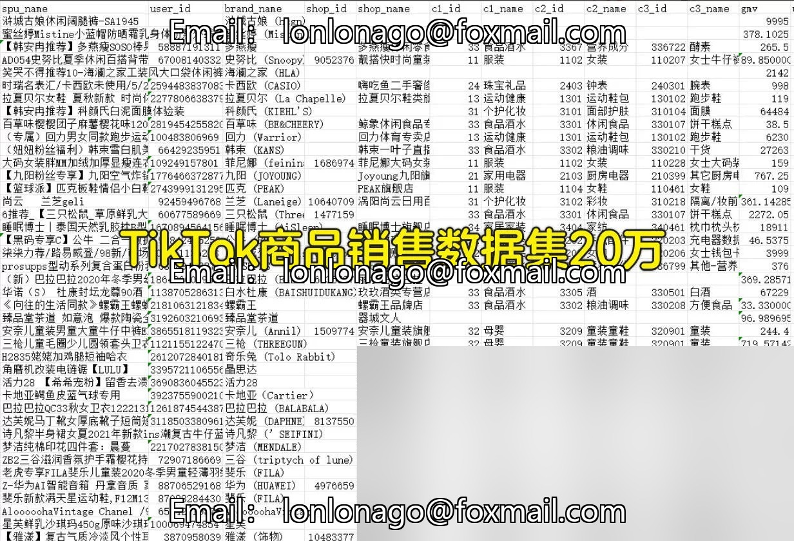

# TikTok product sales dataset of 200,000 records

## Body

TikTok product sales dataset of 200,000 entries
Explanation:
English field | Chinese meaning
spu_id product ID
spu_name product name
user_id user ID
brand_name brand name
shop_id shop ID
shop_name shop name
c1_id first-level category ID
c1_name first-level category name
c2_id second-level category ID
c2_name second-level category name
c3_id third-level category ID
c3_name third-level category name
gmv total product transaction value
unit_sold sales quantity
brand_clean clean standard brand name

web-based shipment, can be directly photographed and shipped.

The dataset covers product sales fields including product ID, name, user ID, brand, shop, category, transaction total and sold quantity, plus a cleaned standard brand name.

<!-- AI_ENRICHED -->

## Images

## Payment

Here is a pay link on Stripe ( https://buy.stripe.com/3cs8yP7sY87d0vu9AB ). Please contact me lonlonago@foxmail.com after funding $89, and I will send you a complete data files , thank you!

